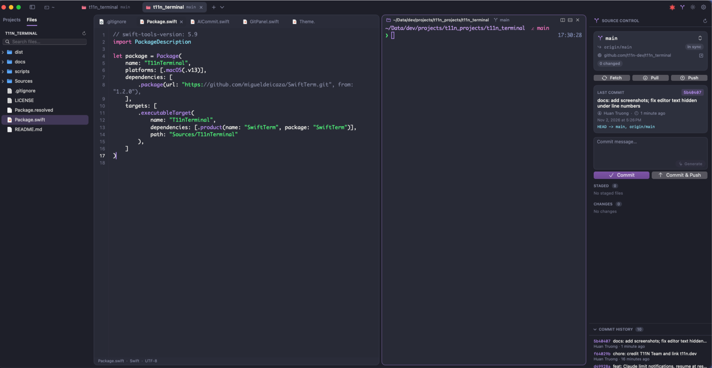
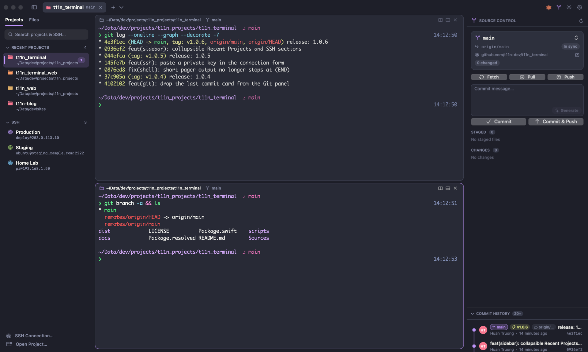
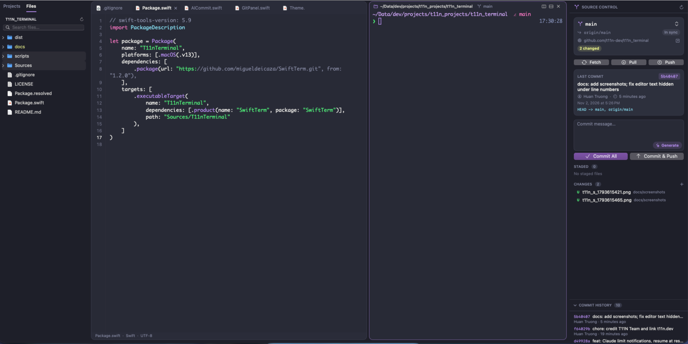

<div align="center">

# T11N Terminal

**A fast, native macOS terminal built around projects.**

Terminals, files, a code editor, Git and Claude Code, together in one lightweight app.

[**Download for macOS**](https://github.com/t11n-dev/t11n_terminal/releases/latest) ·
[Website](https://t11n.dev/) ·
[Release notes](https://github.com/t11n-dev/t11n_terminal/releases) ·
[Report an issue](https://github.com/t11n-dev/t11n_terminal/issues)

[](https://github.com/t11n-dev/t11n_terminal/releases/latest)


[](https://github.com/t11n-dev/t11n_terminal/releases)

<br>



</div>

## Contents

- [Why T11N Terminal](#why-t11n-terminal)
- [Install](#install)
- [Features](#features)
- [Keyboard shortcuts](#keyboard-shortcuts)
- [Privacy](#privacy)
- [Updating and uninstalling](#updating-and-uninstalling)
- [Troubleshooting](#troubleshooting)
- [Support](#support)
- [License and credits](#license-and-credits)

## Why T11N Terminal

Open a folder and it becomes a tab with everything that project needs: split terminals, a file tree, an editor and
a full Git workflow. There is no separate IDE to launch and no browser engine running underneath. The app is native
Swift and AppKit, and uses about 40 MB of memory when idle with one shell.

## Install

**Requirements:** macOS 13 Ventura or later, on Apple Silicon or Intel.

1. Download `T11n-Terminal-<version>-macOS.zip` from the
   [latest release](https://github.com/t11n-dev/t11n_terminal/releases/latest).
2. Unzip it and move **T11n Terminal.app** to **Applications**.
3. Open the app. The first launch needs one extra step, described below.

Each release lists the SHA-256 checksum of its zip. To check your download:

```bash
shasum -a 256 ~/Downloads/T11n-Terminal-*-macOS.zip
```

### Opening the app for the first time

T11N Terminal is not notarized by Apple yet, so macOS blocks the first launch with a message that it cannot verify
the developer. To open it:

1. Try to open the app, then close the warning.
2. Go to **System Settings → Privacy & Security**.
3. Scroll to **Security** and click **Open Anyway** next to T11n Terminal, then confirm.

Or run this once in Terminal:

```bash
xattr -dr com.apple.quarantine "/Applications/T11n Terminal.app"
```

You only need to do this once for each downloaded version.

## Features

<table>
<tr>
<td width="50%"></td>
<td width="50%"></td>
</tr>
</table>

### Terminal

- Full xterm-256color and true-color support, powered by [SwiftTerm](https://github.com/migueldeicaza/SwiftTerm).
- Split panes right or down, from the menu, the pane header or a right-click. Each pane shows its folder and
  Git branch.
- Colored zsh prompt with branch, change markers, exit status and slow-command timer.
- Command highlighting as you type, and suggestions from your history. Press `Tab`, `→` or `End` to accept one.
- Colored `ls`, `grep`, `diff` and `man`.
- Your own setup comes first: oh-my-zsh, starship, powerlevel10k, zsh-syntax-highlighting and zsh-autosuggestions
  are detected and left alone.

### Projects and files

- Every project opens as a tab, and recent projects stay in the sidebar. The Recent Projects and SSH lists can be
  collapsed, and each scrolls on its own.
- File explorer with Git status colors. Right-click to create, rename, copy, paste or trash files and folders, also to
  and from Finder.
- Fuzzy file search that respects `.gitignore`.

### Editor and viewers

- Code editor with line numbers, syntax highlighting for about 20 languages, auto-indent, and find and replace.
- Markdown renders GitHub-style, with a Preview / Source toggle.
- CSV and TSV open as a sortable table.
- PDF, Word, RTF and ODT viewers, plus Quick Look for images, spreadsheets, slides and media.

### Git

- Branch, upstream, ahead/behind counts, remote and stashes at a glance.
- Stage, unstage, discard, view diffs, commit, pull, push, fetch, and switch or create branches.
- Commit history with a **branch graph**, author avatars and branch, remote and tag labels. It loads more as you
  scroll.
- Click a commit to see its message, author, parents and changed files, with a diff for each file.
- **AI commit messages** written on your Mac by Apple Intelligence. No code leaves your computer.
  Requires macOS 26 or later with Apple Intelligence turned on.

### Claude Code

- See your **5-hour and weekly usage** for each account, refreshed every 15 minutes without using any quota.
- Get a notification at 95% and 100% of a limit, and optionally resume waiting sessions when it resets.
- Use several accounts, such as personal and work. All accounts share one session history, so every session stays
  available after you switch. Switching resumes the open session with its full history.
- Sign-in uses Claude Code's own `claude auth login`. T11N Terminal never reads or stores your Claude credentials.

> [!NOTE]
> Account switching is always manual and confirmed. T11N Terminal never rotates accounts automatically. Use
> multiple accounts only as [Anthropic's terms](https://www.anthropic.com/legal/consumer-terms) allow, not to get
> around usage limits.

### SSH

- Connect with a password, a private key (choose the file or paste the key), or your ssh-agent and `~/.ssh/config`.
- Save connections to the sidebar. Each one opens in its own tab.
- Passwords are stored only in the macOS Keychain.
- Browse the server's files in the sidebar. The list follows `cd` where the server's shell reports its folder, and
  shares the terminal's signed-in connection.

### Appearance

- Light, Dark or System mode, with a separate theme for each.
- Themes: Midnight, Graphite, Dracula, Nord, Solarized Dark, Daylight, Paper and Solarized Light.
- Minimum text contrast keeps output readable when a program picks colors meant for the other theme.
- Configurable fonts, cursor, background opacity and more in Settings (`⌘,`).

## Keyboard shortcuts

| Shortcut | Action |
|---|---|
| `⌘N` · `⌘T` · `⌘O` | New window · new tab · open project |
| `⌘D` · `⇧⌘D` | Split right · split down |
| `⌘]` · `⌘[` | Next · previous pane |
| `⌘W` · `⇧⌘W` · `⌥⌘W` | Close pane or file · close tab · close window |
| `⌘1`…`⌘9` · `⇧⌘]` · `⇧⌘[` | Go to tab · next tab · previous tab |
| `⌘B` · `⇧⌘P` · `⇧⌘E` | Toggle sidebar · projects · files |
| `⌥⌘E` | Show or hide the editor |
| `⌃⇧⌘G` | Toggle Git panel |
| `⌘↩` · `⌥⌘G` | Commit · generate commit message |
| `⇧⌘U` | Claude accounts and usage |
| `⇧⌘K` | SSH connection |
| `⌘S` · `⌥⌘S` | Save · save all |
| `⇧⌘V` | Preview ↔ source (Markdown, CSV) |
| `⌘F` · `⌥⌘F` | Find · find and replace |
| `⇧⌘L` | Toggle light / dark |
| `⌘=` · `⌘-` · `⌘0` | Font size |
| `⌘,` | Settings |

## Privacy

- No telemetry. The app only connects to the network through tools you run, such as `git`, `ssh` and `claude`.
- AI commit messages are generated on your Mac.
- SSH passwords stay in your macOS Keychain, and Claude credentials stay with Claude Code.

## Updating and uninstalling

**Update:** download the new zip from the [latest release](https://github.com/t11n-dev/t11n_terminal/releases/latest)
and replace the app in **Applications**. Your settings, projects, SSH connections and Claude accounts are kept.

**Uninstall:**

1. Optional: in the Claude panel, use **Log out & remove** on any extra Claude accounts you added.
2. Quit the app and move **T11n Terminal.app** to the Trash.
3. To remove its data as well, delete these:

| Data | Location |
|---|---|
| Settings, projects and saved SSH connections | `~/Library/Preferences/com.t11n.terminal.plist` |
| Shell integration and Claude account folders | `~/Library/Application Support/T11nTerminal` |
| Saved SSH passwords | Keychain Access, items named **T11n Terminal SSH** |

## Troubleshooting

| Problem | Solution |
|---|---|
| macOS won't open the app | Follow [Opening the app for the first time](#opening-the-app-for-the-first-time). |
| Keychain prompt when connecting over SSH | Choose **Always Allow**. It can appear again after updating the app. |
| Colors or suggestions are missing | They apply to new panes in zsh. Check **Settings → Terminal → Shell integration**. |
| Generate button is disabled | AI commit messages need macOS 26 or later with Apple Intelligence turned on. |
| Claude usage is empty | Install Claude Code and sign in, then click refresh in the Claude panel. |

## Support

Found a bug or have an idea? [Open an issue](https://github.com/t11n-dev/t11n_terminal/issues) with your macOS
version, the app version (**T11n Terminal → About**), the steps to reproduce it and a screenshot if you can.

If T11N Terminal is useful to you, you can support its development on
[Buy Me a Coffee](https://buymeacoffee.com/t11n). It's entirely optional, and the app stays free.

## License and credits

T11N Terminal is proprietary software, free to download and use. See [LICENSE](LICENSE) for the terms.

Made by the [T11N Team](https://t11n.dev/). Terminal emulation by
[SwiftTerm](https://github.com/migueldeicaza/SwiftTerm) from Miguel de Icaza, used under the MIT License.
